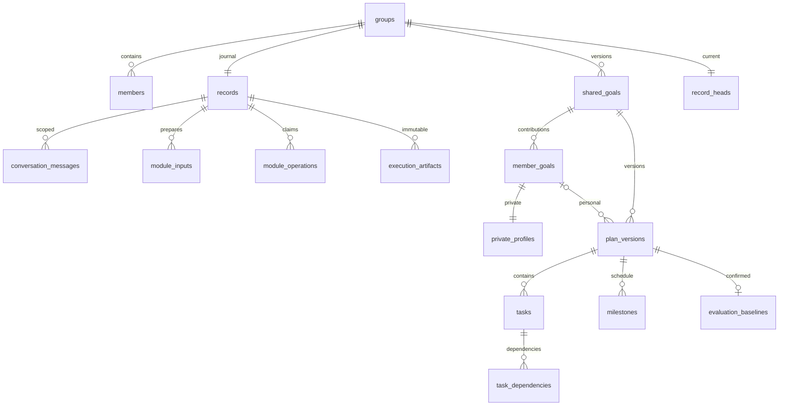

# 공동·개인 목표와 PostgreSQL

현재 설치·SW 코드·권한·백업·복구의 기준 문서는 [PostgreSQL 통합 안내](POSTGRES_INTEGRATION.md)입니다.

M0/M1은 대화로 계획을 만드는 모듈입니다. 코어가 DB를 읽지 않으며 선택적 저장 어댑터가 대화·실행·검토·목표·계획·과제·평가 기준을 같은 PostgreSQL에 저장합니다. A~F 각각을 직접 호출할 수 있습니다.

현재 스키마는 `wemeet_goal`, 마이그레이션은 `0004_private_owner_fk`입니다. `sync_attempts`는 과거 동기화 이력을 보관합니다. 정상 저장은 실행 결과와 정식 목표를 같은 트랜잭션으로 커밋하므로 별도 이중 저장을 하지 않습니다.

현재 PC는 `127.0.0.1:55432/wemeet_goals` 전용 클러스터입니다. 앱 계정은 `wemeet_app`, 관리 계정은 `wemeet_ai`입니다. 계정 정보는 서버 환경변수에만 있습니다. 기존 SQLite는 읽기 전용 백업 자료입니다. 설정을 화면에 붙여 넣지 마세요.

화면에서는 **저장된 목표·과제**를 눌러 공동 목표·개인 기여·실행 과제·참조 ID를 확인합니다. 구성원 선택은 로컬 테스트 장치이며 실제 사용자 인증이 아닙니다. SW에서 로그인과 본인 권한을 연결해야 합니다.
