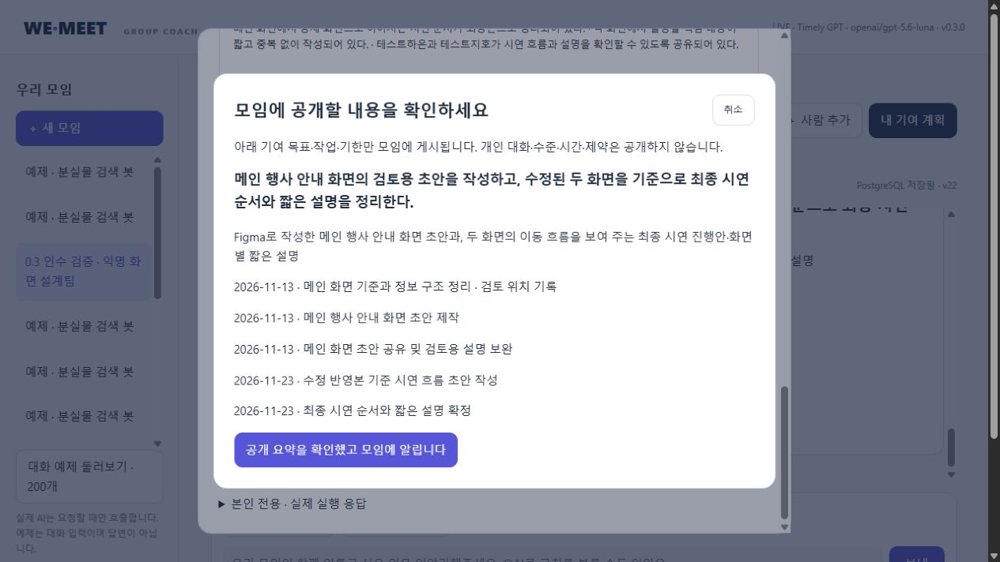

# 0.3.0 — M0/M1 5회 개선·인수 결과

**판정: 운영 인수 보류(HOLD).** 패키지·저장·조회 개선과 정확히 5회 검토를 수행했습니다. 최종 단일 소스 80건에서 API 실행 실패는 없었지만 내용상 중대 결함이 남아, 자동 활성화나 무검토 운영에 바로 연결하면 안 됩니다.

기간: 2026-11-07~2026-11-08. 대상은 `group-coach-v2/wemeet_coach`입니다. 기존 0.15.0 프로젝트는 변경하지 않았습니다.

## 결과를 먼저 읽기

- 최종 회귀 검사: **123 통과, 알려진 결함 2개 예상 실패(xfail), 예상하지 못한 실패 0**. 예상 실패를 정상 통과로 합산하지 않습니다.
- 정식 LIVE: 기준선60 + 다섯 회차 60·60·60·60·80 = **380 시나리오 실행**.
- 5회차 중간 소스80을 별도로 보존했고, 수정 후 최종 단일 소스80을 다시 실행했습니다. 이를 여섯 번째 개선 회차로 세거나 중간 결과를 최종 결과와 섞지 않았습니다. 전체 시나리오 실행은 **460건**입니다.
- 최종80: **OK 75 / NEEDS_INPUT 5 / FAILED 0**. 추가 확인을 API 실패로 집계하지 않습니다.
- 모델 내용 심사: **18.575/20**, 고정60은18.8, 보호20은17.9. 구간 평균은 모두15 이상입니다. 이것은 사람 검토 점수가 아닙니다.
- DB: 잘못된 사용자·모임·계획·과제 연결, 반쪽 커밋, 비공개 원문 공개는 수행한 검사에서 발견하지 못했습니다. M1의 새 제약 처리 결함은 별도로 남아 있습니다.
- 새 환경: 웹·DB 없이 wheel 설치/import/입력 검사, 선택 DB 설치 후 개인 문맥·정확한 기준/과제 조회를 확인했습니다.

## 회차별 실제 결과

| 소스 구간 | 사례 | OK | 추가 확인 | FAILED | 실제 코어 HTTP | 모델 점수/20 |
|---|---:|---:|---:|---:|---:|---:|
| baseline | 60 | 50 | 4 | 6 | 89 | 18.00 |
| round1 | 60 | 56 | 1 | 3 | 85 | 18.80 |
| round2 | 60 | 58 | 0 | 2 | 85 | 18.57 |
| round3 | 60 | 51 | 9 | 0 | 82 | 18.18 |
| round4 | 60 | 51 | 6 | 3 | 89 | 17.80 |
| round5 | 80 | 75 | 5 | 0 | 108 | 18.57 |

1. **코드·계약:** 압축된 제어 흐름을 풀고, 잘못된 JSON 요청을 구조화 오류로 반환했습니다. falsy 주입 런타임이 실제 유료 호출로 바뀌는 경로, 미사용 OFFLINE 분기, 중복 검증 래퍼를 정리했습니다. 98개 검사로 재검사했습니다.
2. **공동 코치:** 마감만 바꾸는 요청이 역할·완료 기준까지 재작성하던 문제를 날짜 부분 수정으로 분리했습니다. `revision_fields`로 수정 범위를 지정하고, 통신 전 인증 오류를 LIVE로 표시하지 않게 했습니다. 102개 검사로 재검사했습니다.
3. **개인 코치:** 수행일과 완료 기한을 분리하고 수행일로 시간 예산을 계산합니다. 숫자 합계는 코드가 제공합니다. 작성 중인 답변을 무시한 계획 생성도 수정했습니다. 107개 검사로 재검사했습니다.
4. **개인화 DB:** `reader.context`와 읽기 전용 일관 스냅샷, 계획-개인목표-공동목표 관계 검사, 공동 계획 중복 방지, 저장만 재시도, 복구 패킷의 원래 실행 전체 비교를 추가했습니다. 120개 검사로 재검사했습니다.
5. **독립 인수·정리:** 새 설치 환경·후속 모듈 조회·커밋 실패 복구·브라우저 흐름을 확인했습니다. 일반 협업 의존성을 진행 불가로 보던 지침을 수정하고, 반복 선택 질문/지원하지 않는 선택 필드가 정상 대화를 통째로 버리지 않게 했습니다. 최종123개 통과와 남은2개 예상 실패를 기록했습니다.

최종 소스 해시: `70e27a16165a0b89ea5f65655f8ccb80dec4b6bde8ca7dc7aaa69abfd04c88c0`.
소스별 파일 해시·판정·사용량은 `docs/evidence/review-030.json`에 있습니다. 최종 wheel의16개 소스 파일이 이 최종 소스와 동일함을 대조했습니다.

## 남은 결함 — 통과로 숨기지 않음

| 우선순위 | 재현 사례 | 확인한 문제 | 다음 재검사 기준 |
|---|---|---|---|
| P1 | `holdout-career-10-b` | 새 ‘유료 도구 불가’를 추가하며 기존 ‘화요일 저녁 긴 작업 불가’를 최신 state에서 대체함. plan=null인데 ‘계획을 작성했습니다’라는 문구도 남음 | 추가/교체/철회를 구별하고 기존 확인 조건 보존. 미생성 결과는 작성 완료로 안내하지 않음 |
| P1 | `holdout-habit-09-b`, `propose-habit-02-b` | 반복 횟수·실제 수행 과제 수·시간·선후 관계가 일치하지 않음. 여러 주 반복을 시작일 하나의 작업으로 표현하기도 함 | 반복 수행별 일정/시간 또는 명시적 반복 계약으로 횟수·총량·의존성이 일치 |
| P1 | `propose-creative-02-b` | 영상 완성이 목표인데 장면·자막·검증만 있고 실제 촬영/편집/통합본 완성 경로가 빠짐 | 최종 산출물까지 필요한 작업을 포함하거나 계획 범위가 기획안뿐인지 명확히 확인 |

실제 익명 입력과 응답은 `evaluations/regressions-030.json`에 보존했습니다. 첫 결함은 `tests/test_known_failures.py`에서 유료 호출 없이 두 예상 실패로 재현됩니다. 수정 없이 xfail을 삭제해 통과 수를 높이면 안 됩니다.

모델이 중대 후보로 표시한 사례는26개입니다. 그 자체를 모두 확정 결함으로 보지 않습니다. 예를 들어 선택적인 가능 요일 미확인을 필수 관문으로 보거나, JSON 내부 의존성에서 외부 공동 작업 ID가 빠졌다는 이유만으로 잘못된 계획이라고 판단한 항목도 있습니다. 실제 계약·입력·조건부 실행 규칙과 대조해야 합니다. 모든 후보가 해소됐거나 에이전트 전수 의미 판정이 끝났다고 선언하지 않습니다.

## DB와 사용자의 자료

검사 연결: `external_user_id → group_id/member_id → 대화·확인 조건 → 공동/개인 목표 → plan_version_id → task_id → baseline_id`.

- 같은 사용자의 여러 모임, 동명 사용자, 1·2·3·5·8명 모임, 동시 요청·중복 저장·옛 revision·개인 계획 부분 실패를 실제 격리 PostgreSQL 검사에 포함했습니다.
- PERSONAL 조회 소유자는 SW가 검증한 ActorContext로 결정합니다. 다른 owner를 요청 인자로 넣어 바꿀 수 없습니다.
- `reader.context`는 한 REPEATABLE READ / READ ONLY 트랜잭션에서 읽으며 대화·개발자 로그를 기본 결과로 보내지 않습니다.
- 현재 버전은 저장 포인터, 과거는 명시적 버전 ID로 조회합니다. 확인 전 초안·옛 조건·형식/관계 오류를 READY로 표시하지 않습니다.
- 마이그레이션0006은 기존 테이블 내용을 바꾸지 않고 계획 관계와 공동 계획 유일성을 보강합니다. 사전 관계 검사·백업·별도 복원을 거쳤고 적용 전후 전체 테이블 해시가 같았습니다.
- 기존0.15 소스60개와 DB17개 테이블은 이전 해시와 같았습니다. 8010·8020 서버 응답은200, 8020의 실제 버전은0.3.0입니다.
- 기존 새 프로젝트 자료 중 외부 사용자 ID 미연결 구성원2030개는 추정 연결하지 않았습니다. 과거 공동 계획19개에는 기준이 없지만 **현재 승인된 공동 계획의 기준 누락은0개**입니다. 과거 승인을 만들어 기준을 채워 넣지 않았습니다.

### 실제 AI 응답 후 커밋 실패

익명1명 모임에서 실제 PROPOSE·PLAN을 실행한 뒤, 격리 DB의 지연 FK 검사로 커밋을 실패시켰습니다.
계획·과제가 반쯤 남지 않았고 SAVE_PENDING을 반환했습니다. 암호화 응답을 저장만 재시도해 동일 계획 ID로 복구했습니다. 반복 저장 재시도 신규 HTTP는0입니다. 기준 확정 후 새 프로세스의 최소 문맥은 READY이며 baseline/plan/task 관계가 일치했습니다. 이 흐름의 실제 AI는 HTTP2회였습니다.

## 브라우저에서 확인한 범위

- 익명3명 추가 → 공동 계획 LIVE → 모의 전원 찬성 → 개인 버튼 상담.
- 수준·시간·범위·진척·도구·제약 건너뛰기 답변과 개인 계획 생성.
- 개인 계획을 직접 수정해 새 버전 저장, 기존 버전 보존, 공개 요약/모임 게시와 기준 ID 일치.
- 새로고침·검증 서버 재시작 후 공동 대화·승인·개인 조건 복원, 테스트 발언자와 미전송 입력 복원.
- 질문·답변 버튼을 긴 요약보다 먼저 표시. 긴 설명은 제거하지 않고 펼쳐 보기로 유지.
- 390·768·1024·1440px에서 입력·버튼·계획의 가로 잘림을 확인했고, 임시 viewport 설정은 해제했습니다.
- 공유 전 별도 확인을 제거하는 변경은 자동 검토가 거부했습니다. 보호 단계를 유지하는 화면 내 확인창으로 대체했고, 공개 요약만 표시·취소 복귀를 확인했습니다. 중간에 브라우저 도구가 장시간 멈춘 구간은 정상 작업 시간이나 AI 지연으로 집계하지 않습니다.

공개 요약에는 수준·시간·제약·개인 원문이 없었습니다. DB에서 공유 이벤트1개와 최신 수정 계획 ID의 일치를 확인했습니다. 이 모임의 AI는 HTTP8회였고, 수정·투표·복원·미리보기·취소·조회에는 유료 호출이 없었습니다.

## 실제 사용량과 판정 구분

| 용도 | 실제 HTTP | 토큰 |
|---|---:|---:|
| 정식380 시나리오의 코어 | 538 | 3,353,826 |
| 정식 내용 심사 | 190 | 2,500,426 |
| 별도 보존한 5회차 중간80 | 117 | 736,908 |
| 폐기한 심사 보정 | 25 | 408,920 |
| 브라우저 익명 흐름 | 8 | 53,913 |
| 실제 커밋 실패/복구 흐름 | 2 | 11,024 |
| 합계 | 880 | 7,065,017 |

초기 심사50건은 공동 요청에 없던 비공개 조건을 심사자에게 전달한 문제가 있어 정식 점수에서 제외했습니다. 실제 비용이 든 호출·토큰은 합계에서 제외하지 않았습니다. 수정한 동일 심사 기준으로 정식380건을 평가했습니다.
부모/하위 실행을 중복 합산하지 않았고 실제 run_id로 사용량을 모았습니다. 캐시·작성된 가짜 응답·코드 검사를 LIVE로 집계하지 않았습니다. 초기 기준선은 직렬 실행했고 이후 독립 묶음은 병행했습니다. 전체 실행이 동시성1이었다고 주장하지 않습니다.

기존 사용자 원문은 외부에 재전송하지 않았습니다. 보관된 원본 DB/복구/실행 기록은 삭제하지 않았습니다. 사람의 직접 검토와 SW팀의 실제 인수는0건이며 별도 대기입니다.

## 전달 파일과 사용 순서

1. `README.md`: 모듈 선택·설치·호출·결과 분기.
2. `docs/USER_STORAGE.md`: 사용자 연결·권한·저장/재개·최소 조회·백업.
3. `examples/core.py`: 그룹/개인 독립 호출. `--check`는 계약 검사, `--live`는 실제 호출.
4. `examples/stored_flow.py`: 익명 모의 수락이 명시된 저장 연결·중단 후 재개.
5. `examples/read_goals.py`: 인증된 사용자 범위의 후속 문맥 조회.
6. `docs/contracts`: JSON Schema/OpenAPI. `docs/manifest.json`: 해시·검증 범위·HOLD 상태.

이 패키지는 개발·검토용으로 인수할 수 있지만 운영 준비 완료는 아닙니다. 다음 수정 우선순위는 **조건 추가/교체 구별 → 반복 작업 계약과 총량 검사 → 최종 산출물 경로 완결성**입니다. 각 항목은 보존한 재현 입력으로 다시 검사해야 합니다. 이번5회 결과를 여섯 번째 개선 없이 완료로 포장하지 않습니다.
